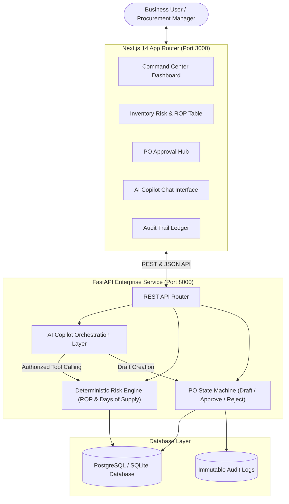

# SupplyChain Copilot AI (Enterprise ERP Intelligence)

> An enterprise-grade Supply Chain & ERP intelligence copilot combining **deterministic risk engines**, **relational database constraints**, **human-in-the-loop purchase order workflows**, and **guarded LLM tool calling**.


---

## 📌 Executive Summary

Enterprise ERP systems require deterministic accuracy for operational decisions like stock replenishment, supplier evaluation, and financial commitments. Standard conversational LLMs risk hallucinating inventory numbers or executing dangerous raw SQL.

**SupplyChain Copilot AI** solves this through a layered architecture:
1. **Deterministic Risk Engine:** Pure Python mathematical calculations for Reorder Point (ROP) and Days of Physical Supply.
2. **State-Guarded PO Lifecycle:** Purchase orders transition through a strict state machine (`DRAFT` $\rightarrow$ `APPROVED` or `REJECTED`), preventing race conditions and double-approvals.
3. **Controlled Tool Calling:** The AI Copilot only interacts with validated backend tools (`get_inventory_risks`, `get_supplier_metrics`, `explain_product_risk`) with zero raw SQL execution privileges.
4. **Immutable Audit Ledger:** Every automated suggestion and human authorization is logged with timestamps and actor attribution for SOX/ERP compliance.

---

## 🏗️ Architecture



---

## 🧮 Deterministic Business Logic & Formulas

### 1. Reorder Point (ROP)
$$\text{ROP} = (\text{Average Daily Demand} \times \text{Supplier Lead Time in Days}) + \text{Safety Stock}$$

### 2. Days of Physical Supply
$$\text{Days of Supply} = \frac{\text{Current Physical Stock}}{\text{Average Daily Demand}}$$

### 3. Risk Tiers
* **🚨 Critical Stockout Risk:** $\text{Days of Supply} \le \text{Supplier Lead Time}$  
  *(Physical stock will deplete to zero before standard supplier shipment can arrive)*.
* **⚠️ Reorder Threshold Breach:** $\text{Effective Stock} (\text{Current} + \text{Incoming}) \le \text{ROP}$  
  *(Buffer depleted below target reorder point)*.
* **✅ Healthy:** $\text{Effective Stock} > \text{ROP}$.

---

## 🚀 Key Modules & Capabilities

| Module | Purpose | Key Enterprise Feature |
|---|---|---|
| **Command Center** | Executive KPI overview | Real-time stockout alerts, inventory valuation breakdown |
| **Inventory Risk Hub** | ROP monitoring & reorder triggers | "Formula" modal showing exact mathematical steps; 1-click PO draft |
| **Supplier Scorecards** | Vendor performance tracking | Contract lead times, reliability scores, on-time delivery rates |
| **Purchase Order Hub** | Replenishment approval workflow | State-machine validation (`DRAFT` $\rightarrow$ `APPROVED`/`REJECTED`); rejects double-approvals |
| **AI Copilot** | Grounded operational assistant | Controlled function calling, tool execution audit chips, prompt pills |
| **Audit Trail** | Non-repudiation & compliance | Immutable ledger tracking actor ID, action type, and timestamps |

---

## 🛠️ Tech Stack

* **Frontend:** Next.js 14 (App Router), TypeScript, Tailwind CSS, Lucide Icons.
* **Backend:** Python 3.12, FastAPI, SQLAlchemy 2.0, Pydantic v2, Pytest.
* **Database:** SQLite (local zero-friction dev) / PostgreSQL (production connection via `DATABASE_URL`).
* **AI Orchestration:** Guarded Tool Calling with dual-engine support (OpenAI/Gemini API key or deterministic offline router).

---

## ⚡ Quick Start

### 1. Backend Setup
```bash
cd backend
python -m venv venv
# On Windows:
venv\Scripts\activate
# On Linux/macOS:
source venv/bin/activate

pip install -r requirements.txt
alembic upgrade head
python -m app.services.seed_data
pytest -v
uvicorn app.main:app --host 127.0.0.1 --port 8000
```

### 2. Frontend Setup
```bash
cd frontend
npm install
npm run build
npm run start -p 3000
```

Open **`http://localhost:3000`** in your browser.

---

## 🧪 Automated Testing

Unit tests cover critical deterministic supply chain calculations and state-machine transitions:
```bash
cd backend
pytest -v
```
**Test Coverage:**
* `test_critical_stockout_risk`: Confirms trigger when Days of Supply $\le$ Lead Time.
* `test_reorder_required_when_below_rop`: Validates ROP calculation and buffer replenishment.
* `test_healthy_inventory_level`: Validates optimal stock states.
* `test_po_lifecycle`: Validates DRAFT creation, approval, and rejection of double-approvals (HTTP 409 Conflict).

---

## 🛡️ Enterprise Security & Guardrails

1. **Zero Raw SQL Execution:** The LLM agent has no direct database access; it interacts exclusively through deterministic Python functions with validated schemas.
2. **Human-in-the-Loop (HITL):** The Copilot can propose and draft purchase orders, but **never finalize or disburse capital** without human approval.
3. **Optimistic Locking & State Guards:** Prevents race conditions and double-approvals on financial purchase orders.
